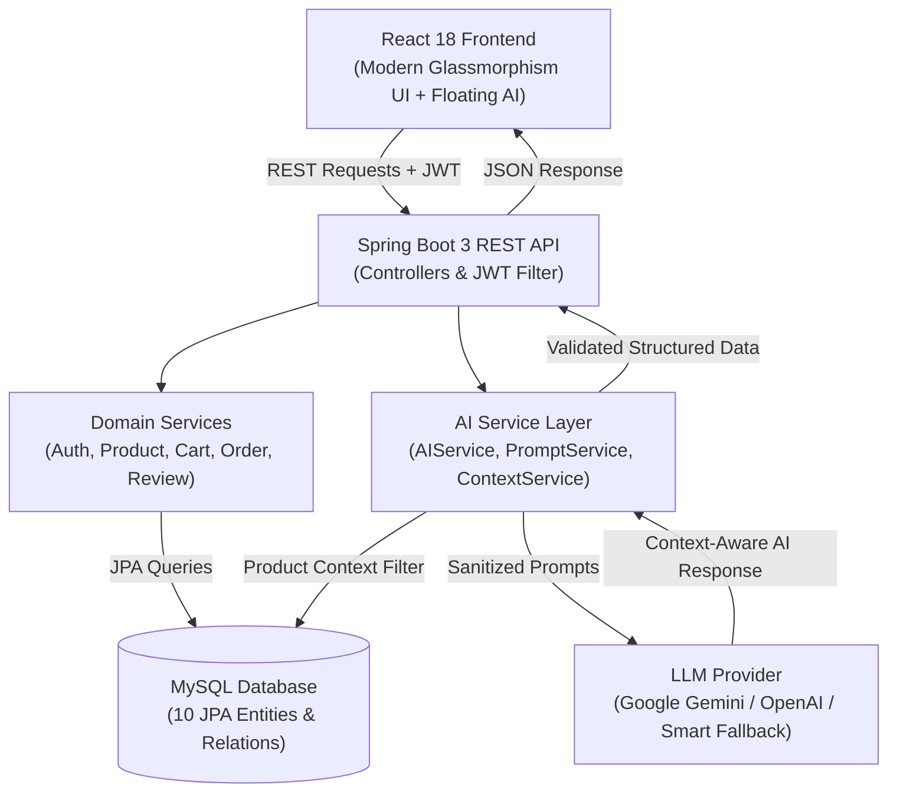
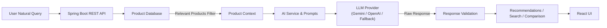

# ElectroShop AI

> **AI-Powered E-Commerce Platform using React, Spring Boot, and AI**

ElectroShop AI is a modern, full-stack, enterprise-grade e-commerce application upgraded with cutting-edge artificial intelligence capabilities. It seamlessly combines a robust Java Spring Boot 3 REST API backend, a sleek React 18 glassmorphism frontend, a MySQL database, JWT security, and LLM integrations (Gemini / OpenAI).

---

## 🚀 Features Overview

### 🛒 Core E-Commerce Features
- **User Authentication**: Secure Registration and Login with Spring Security & JWT Bearer tokens.
- **Product Management & Catalog**: Category browsing, brand filters, price sliders, detailed specifications, stock tracking, and rating system.
- **Cart & Checkout**: Real-time cart state management, quantity controls, address checkout, and payment options.
- **Order Management**: Order placement, order history tracking, and itemized receipts.
- **Wishlist**: Save favorite products with 1-click toggles.
- **Review & Rating System**: Customer ratings (1-5★) and verified reviews with instant average rating calculation.
- **Admin Dashboard**: Full CRUD management of inventory, customer order status management, and real-time revenue/query metrics.

### 🤖 AI-Powered Features
1. **ElectroShop AI Assistant**: Floating AI assistant and full-page chat interface that recommends real database products with prices and specifications in response to natural-language user queries.
2. **Natural Language Product Search**: "Ask AI" search mode parsing query parameters (e.g. *"Show me laptops under ₹80,000 with at least 16GB RAM"*) into structured DB parameters without inventing fake products or executing unsafe SQL.
3. **AI Recommendation Engine**: Hybrid personalization analyzing user view history, cart items, order history, category preferences, and top-rated products with human-readable AI explanations.
4. **AI Product Comparison**: Select 2–4 products and generate side-by-side spec comparison tables with AI evaluation summaries and badges (*BEST FOR PROGRAMMING*, *BEST VALUE*, *BEST PERFORMANCE*).
5. **AI Review Summarization**: Automatically summarizes customer reviews into pros, cons, and overall satisfaction summaries cached per product (`GET /api/products/{id}/ai-review-summary`).
6. **AI Product Description Generator**: Admin tool to generate rich product descriptions, key features, and SEO copy from raw specifications with mandatory **Admin Review & Approval** before saving.
7. **AI Cart Assistant Suggestions**: Dynamically recommends complementary accessories and items present in the database based on items in the user's cart.
8. **Smart Budget Assistant**: Finds and ranks products matching a target budget and purpose (e.g., Programming, Gaming, Photography) with match percentage scores and reason checklists.
9. **AI Conversation History**: Persists user chat sessions in `ai_conversations` and `ai_messages` tables with continue/delete management.

---

## 🛠️ Tech Stack

### Frontend
- **Framework**: React 18 (React Router v6)
- **Styling**: Vanilla CSS3 (Custom Glassmorphism design system, Outfit & Plus Jakarta Sans typography, CSS variables, dark theme)
- **Icons**: Lucide React
- **HTTP Client**: Axios with JWT Interceptors

### Backend
- **Framework**: Java 17, Spring Boot 3.2
- **Security**: Spring Security 6, JJWT (JSON Web Token)
- **Data Access**: Spring Data JPA / Hibernate
- **Database**: MySQL 8.0 (with H2 in-memory fallback for local development)
- **API Documentation**: OpenAPI 3.0 / Swagger UI (`springdoc-openapi`)
- **Testing**: JUnit 5, Mockito, Spring Boot Test

### AI Integration
- **LLM Providers**: Google Gemini API (`gemini-1.5-flash`), OpenAI API (`gpt-3.5-turbo`), and `SmartFallbackAIProvider` (ensures zero-downtime execution out-of-the-box).

---

## 📐 System Architecture



### AI Context & Safety Pipeline



---

## 📁 Project Structure

```
ElectroShop/
├── backend/
│   ├── src/main/java/com/electroshop/
│   │   ├── ai/            # AI Provider abstractions, PromptService, RecommendationService, ReviewSummaryService
│   │   ├── config/        # SecurityConfig, OpenApiConfig, DataInitializer
│   │   ├── controller/    # Auth, Product, Cart, Order, Review, Wishlist, AI, Admin Controllers
│   │   ├── dto/           # Request and Response DTOs
│   │   ├── entity/        # JPA Entities (User, Product, Category, Order, Review, AIConversation, etc.)
│   │   ├── exception/     # GlobalExceptionHandler and Custom Exceptions
│   │   ├── repository/    # Spring Data JPA Repositories
│   │   ├── security/      # JwtUtils, JwtAuthenticationFilter, UserDetailsService
│   │   └── service/       # Application Domain Services
│   ├── src/test/java/     # Backend JUnit 5 & Mockito Unit Tests
│   ├── pom.xml
│   └── Dockerfile
├── frontend/
│   ├── src/
│   │   ├── components/    # Navbar, Footer, ProductCard, FloatingAIAssistant, Toast
│   │   ├── context/       # AuthContext, CartContext, ToastContext
│   │   ├── pages/         # 16 UI Pages (Home, Products, Details, AIAssistant, Cart, Checkout, Orders, Wishlist, Profile, AIHistory, Compare, Budget, Admin Pages)
│   │   ├── services/      # Axios API Client
│   │   ├── App.js         # React Router Configuration
│   │   └── index.css      # Design System Tokens & Glassmorphism Theme
│   ├── package.json
│   └── Dockerfile
├── docker-compose.yml
├── .env.example
└── README.md
```

---

## 🗄️ Database Schema

Entities & Relationships:
- **`users`**: `id`, `username`, `password`, `email`, `role` (`ROLE_USER` / `ROLE_ADMIN`), `created_at`
- **`products`**: `id`, `name`, `brand`, `category`, `price`, `description`, `specs`, `image_url`, `rating`, `review_count`, `is_featured`
- **`categories`**: `id`, `name`, `description`, `icon`
- **`cart_items`**: `id`, `user_id`, `product_id`, `quantity`
- **`orders`**: `id`, `user_id`, `total_amount`, `status`, `shipping_address`, `payment_method`, `created_at`
- **`order_items`**: `id`, `order_id`, `product_id`, `price`, `quantity`
- **`reviews`**: `id`, `user_id`, `username`, `product_id`, `rating`, `comment`, `created_at`
- **`wishlists`**: `id`, `user_id`, `product_id`, `created_at`
- **`ai_conversations`**: `id`, `user_id`, `title`, `created_at`, `updated_at`
- **`ai_messages`**: `id`, `conversation_id`, `role`, `content`, `created_at`
- **`product_views`**: `id`, `user_id`, `product_id`, `viewed_at`

---

## 🔌 Key REST APIs

| Endpoint | Method | Security | Description |
| :--- | :--- | :--- | :--- |
| `/api/auth/register` | `POST` | Public | Register new user |
| `/api/auth/login` | `POST` | Public | Login & obtain JWT token |
| `/api/products` | `GET` | Public | List all electronic products |
| `/api/products/{id}` | `GET` | Public 
| Get product details & log view |
| `/api/products/search` | `GET` | Public | Search and filter products by price & category |
| `/api/cart/{userId}` | `GET` | Authenticated | Get user shopping cart |
| `/api/cart/add` | `POST` | Authenticated | Add item to cart |
| `/api/orders/checkout` | `POST` | Authenticated | Checkout cart items into order |
| `/api/products/{id}/reviews` | `GET` / `POST` | Public / Auth | Get/add product reviews |
| `/api/products/{id}/ai-review-summary` | `GET` | Public | Get cached AI review summary |
| `/api/ai/chat` | `POST` | Public / Auth | Send query to AI Assistant |
| `/api/ai/search` | `POST` | Public | Natural language AI product search |
| `/api/ai/compare` | `POST` | Public | Generate AI product comparison |
| `/api/ai/recommendations` | `GET` | Public / Auth | Get personalized AI recommendations |
| `/api/ai/budget-assistant` | `POST` | Public | Find ranked products matching budget |
| `/api/admin/products` | `POST` / `PUT` | Admin | Create or edit products |
| `/api/admin/products/generate-description` | `POST` | Admin | Generate AI product listing copy |
| `/api/admin/stats` | `GET` | Admin | Get platform metrics |

---

## 🔑 Setup & Environment Variables

Copy `.env.example` to `.env`:

```env
AI_PROVIDER=gemini
GEMINI_API_KEY=your_gemini_api_key
OPENAI_API_KEY=your_openai_api_key
JWT_SECRET=9a4f2c8d7e6b5a4f3e2d1c0b9a8f7e6d5c4b3a2f1e0d9c8b7a6f5e4d3c2b1a0f
SPRING_DATASOURCE_URL=jdbc:mysql://localhost:3306/electroshopdb?useSSL=false&allowPublicKeyRetrieval=true&serverTimezone=UTC
SPRING_DATASOURCE_USERNAME=root
SPRING_DATASOURCE_PASSWORD=rootpassword
```

---

## 💻 Running Locally

### 1. Run Spring Boot Backend
```bash
cd backend
mvn spring-boot:run
```
Backend runs at: `http://localhost:8080`  
Swagger API Docs available at: `http://localhost:8080/swagger-ui.html`

### 2. Run React Frontend
```bash
cd frontend
npm install --legacy-peer-deps
npm start
```
Frontend opens at: `http://localhost:3000`

---

## 🐳 Docker Setup

Run the entire application (MySQL + Backend + Frontend) using Docker Compose:

```bash
docker compose up --build
```

---

## 👤 Author

Developed with ❤️ by **Disha Bidikar**  
GitHub Profile: [https://github.com/disha-bidikar](https://github.com/disha-bidikar)  
Repository: [https://github.com/disha-bidikar/ElectroShop](https://github.com/disha-bidikar/ElectroShop)
